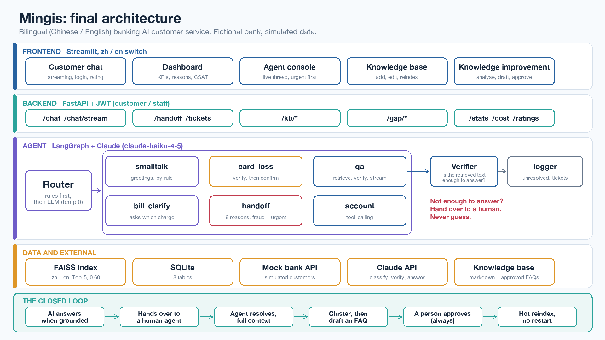

# Mingis: Bilingual Banking AI Customer-Service Agent

🎬 **Demo video**: [Watch](https://drive.google.com/file/d/1DLwS8EmWASVOZM4orz_-DIFdo2rz5x4h/view?usp=sharing) ｜ 🇹🇼 [中文版（繁體）在頁面最下方 / Chinese version at the bottom](#zh-tw)

> **When the AI cannot answer, it hands the case to a human agent; the agent's resolution becomes a new knowledge-base answer once a person approves it.**
>
> LangGraph · Claude · RAG (FAISS) · FastAPI · Streamlit ｜ Demo project: a fictional bank, all customer and banking data are simulated.



> **About this repository**: this is a cleaned snapshot prepared for public viewing. The design history lives in [`docs/design_journal.md`](docs/design_journal.md) and [`docs/ADR.md`](docs/ADR.md); the final architecture is in [`docs/architecture.md`](docs/architecture.md). The architecture, ADR and evaluation documents have English and Traditional Chinese editions; the rest of the design documents are in Traditional Chinese.

Mingis is a bilingual (Chinese/English) AI customer-service agent for a fictional bank. Most chatbot demos stop at "it can answer FAQs". This project is about **what happens when the AI should not answer**.

---

## 30-second overview

| Design | What it does, and what was measured |
|--------|-------------------------------------|
| **Answer only with evidence** | Before every reply, a separate check decides whether the retrieved text really answers the question; if not, the case goes to a human agent instead of being guessed. Testing showed that when the knowledge base had no answer, the model still invented a plausible reason. On 12 questions the knowledge base has no answer for, only 5 used to be handed to a human; after checking before every reply, all 12 were. **Cost**: about 3 seconds more before the first word, and more answerable questions are handed over too (3 → 11 out of 62). |
| **Rules first, LLM second** | In-progress flows, greetings and vague bill complaints are handled by deterministic rules; everything else goes to an LLM classifier at temperature 0, so the same sentence always takes the same path. Suspected fraud is flagged urgent; reporting a lost card requires identity verification and an explicit confirmation. |
| **A human at the critical points** | A human agent sees the whole conversation, so the customer never has to repeat themselves. Nothing enters the knowledge base without a person's approval, and an approved entry takes effect without a restart. |
| **Verifiable and traceable** | 269 automated tests (including evaluations that call the real model and security tests), 20 architecture decision records ([ADR](docs/ADR.md)), a sprint-by-sprint [design journal](docs/design_journal.md), and LLM cost and latency tracking. |

> **An honest note on measurement:** the figures above come from small, hand-picked samples (62 answerable questions and 12 questions with no answer in the knowledge base). They are directional evidence that the gap is closed, **not an overall accuracy rate**. A retrieval score means "relevant content was found", not "the answer is correct". Methods and limits: [`docs/evaluation.md`](docs/evaluation.md).

## What this project shows

```
Customer asks
   │
   ├─ Knowledge base answers well   → answer directly (streamed token by token)
   ├─ Score is ambiguous            → the AI first checks whether the chunks are enough
   │                                  → not enough: hand to a human agent, no guessing
   └─ Fraud / dispute / approval…   → 9 business rules hand it to a human agent,
                                      each recorded separately
                                    │
                              A human agent replies (two-way, live conversation)
                                    │
                              Customer rates 1–5 (low scores ask why)
                                    │
                    The AI clusters "unresolved + low-score + agent replies" into topics
                                    │
                    Draft an FAQ → staff review → one-click publish + hot reindex
                                    │
                    Measured effect: retrieval confidence for the same question
                    0.53 → 0.70 (crossing the threshold)
```

## Features

| Feature | Description |
|---------|-------------|
| **FAQ answers (RAG)** | FAISS vector retrieval + Claude generation, grounded in the knowledge base, with sources shown |
| **Suggested questions** | Starter shortcuts on an empty chat and follow-ups based on the sources actually retrieved; **only questions verified to be answerable are shown**, so a click never ends in a handoff dead end |
| **Grounding verifier** | Before every FAQ answer, an independent check asks whether the chunks really answer the question; if not, hand off (12 of 12 real gaps caught; `VERIFY_ALWAYS=0` restores "only when the score is low", see ADR-020) |
| **Account queries** | After login, tool-calling fetches balance / bill / transactions, only what the question needs |
| **Lost-card flow** | Three-step identity-verified workflow, cancellable at any point |
| **Handoff to a human** | 9 business trigger rules (fraud, dispute, approval needed, sensitive data change, distress, cross-account…), each classified and recorded separately |
| **Two-way live chat with an agent** | Agent and customer share one conversation thread; both sides refresh every 5 seconds |
| **Greeting replies** | "Hello", "Thanks" and the like are answered by a router rule: no knowledge-base lookup, no handoff (ADR-018) |
| **Clarify vague bill complaints** | When a customer only says "my bill is wrong", Mingis asks which charge first, then hands over with the detail attached (rule before the LLM classifier, ADR-017) |
| **Guest intake before handoff** | A guest who asks for a person is asked for a category and a description, written into the ticket so the agent can start right away |
| **Satisfaction rating (CSAT)** | 1–5 faces, low scores ask why, aggregated on the dashboard |
| **Knowledge-base maintenance** | Add / edit / archive entries in the web UI; one-click reindex with **hot swap, no restart**; retrieval test tool |
| **Knowledge improvement** | The LLM clusters failure signals → drafts de-identified FAQs → staff review and publish → before/after retrieval confidence |
| **Bilingual** | Customer chats are language-detected with separate indexes; the whole platform (customer UI and four staff pages) switches between English and 中文 from the sidebar (**English is the default**), remembered in the URL as `?lang=` |

## The four interfaces

Switch from the left sidebar:

| Page | For | What it does |
|------|-----|--------------|
| **app** (home) | Customer | Chat, log in for account queries, live conversation after handoff, rating when done |
| **📊 Dashboard** | Manager | 4 KPIs (total tickets / open / done / unresolved queries), ticket and query statistics, trigger-reason analysis, CSAT and low-score feedback; LLM cost and latency in a collapsed "developer info" block; click any recent query or ticket to open its conversation and full record |
| **🧑‍💼 Agent console** | Human agent | Conversation on top, open-ticket list below (urgent first, waiting time, filters); reply to the customer (auto-refresh), mark resolved (confirmed, reversible) |
| **📚 Knowledge base** | Knowledge ops | Add / edit / archive supplementary knowledge, a "N changes not yet applied" reminder, reindex takes effect immediately, retrieval score tester |
| **🧩 Knowledge improvement** | Knowledge ops | Analyse what needs improving, review AI-drafted FAQs, track the effect after publishing |

## Architecture notes

- **LLM**: `claude-haiku-4-5`. Intent classification, grounding verification, gap clustering and draft writing all use forced `tool_choice` structured output; free text is never parsed.
- **RAG**: FAISS `IndexFlatIP` with normalised vectors (= cosine), Top-K 5, confidence threshold **0.60**; chunks are split on markdown headings (`##` / `###`) and embedded together with their heading path (ADR-016).
- **Database**: SQLite (`data/banking.db`): `tickets`, `unresolved_queries`, `handoff_messages`, `satisfaction_ratings`, `kb_entries`, `kb_gap_drafts`, `llm_calls` (cost and latency), `chat_sessions`.
- Full architecture document (system diagram, LangGraph flow, closed-loop sequence, tables, API, security, known limitations): [`docs/architecture.md`](docs/architecture.md).

## Known limitations (demo scope)

- Single machine, single user: no rate limiting, caching or horizontal scaling.
- Live updates use 5-second polling; production should use WebSocket / SSE.
- Workflow state lives in the front-end session, so a page refresh interrupts it (production: Redis).
- The banking back office is a mock API; no real financial operation is performed.
- Demo passwords are fake data compared in plain text, only to show the login flow.

---

## Quick start

### 1. Setup

```bash
git clone https://github.com/YvetLo/mingis-banking-ai-agent.git
cd mingis-banking-ai-agent
pip install -r requirements.txt

cp .env.example .env
# Edit .env and fill in the required values. There are no defaults: the backend refuses to
# start if they are missing or still hold the example values.
#   ANTHROPIC_API_KEY                  your Claude API key
#   JWT_SECRET_KEY                     at least 32 characters, generate it with the command below
#   STAFF_USERNAME / STAFF_PASSWORD    shared login for the staff pages
python -c "import secrets; print(secrets.token_urlsafe(48))"
```

### 2. Build the vector index (first run)

```bash
python -m backend.src.rag.build_index
```

It downloads the embedding model `paraphrase-multilingual-mpnet-base-v2`, splits the markdown in `data/knowledge_base/` into chunks and builds a FAISS index in `data/faiss_index/`.

### 3. Run (two terminals)

```bash
# backend
uvicorn backend.main:app --reload

# frontend
streamlit run frontend/app.py
```

| URL | Purpose |
|-----|---------|
| http://localhost:8501 | Customer chat UI (English by default; add `?lang=zh` for Chinese) |
| http://localhost:8000/docs | Backend API docs (Swagger) |

### 4. Demo accounts

| Username | Password | Persona |
|----------|----------|---------|
| `demo_user1` | `demo1234` | Chen Xiao-Ming, office worker, 2 credit cards |
| `demo_user2` | `demo5678` | Wang Da-Ming, business person, unlimited card |
| `demo_user3` | `demo9999` | Chen Chun-Hua, retiree with a time deposit |

---

## Project structure

```
mingis-banking-ai-agent/
├── backend/
│   ├── main.py                    FastAPI app and all endpoints
│   └── src/
│       ├── agent/                 LangGraph: graph / nodes / state / intent /
│       │                          verifier / handoff / gap_pipeline / tools
│       ├── rag/                   build_index.py (indexing), retriever.py (retrieval)
│       ├── mock_api/              mock banking API and fake data
│       ├── database.py            SQLite schema and all CRUD
│       ├── prompts.py             system prompts and reply templates
│       ├── card_loss_workflow.py  lost-card flow
│       └── nlp.py                 language detection, negative feedback
├── frontend/
│   ├── app.py                     customer chat UI
│   └── pages/                     Dashboard / Agent console / Knowledge base / Knowledge improvement
├── data/
│   ├── knowledge_base/{zh,en}/    knowledge-base markdown, 9 files each
│   ├── faiss_index/               vector index, produced by build_index
│   └── banking.db                 SQLite
├── docs/                          design documents (see below)
└── tests/                         pytest, 269 tests
```

## Tests

```bash
python -m pytest -q          # all 269, including evals that call the real model
python -m pytest tests/test_handoff.py -q
```

Tests use a separate `test.db` (via `BANKING_DB_PATH`) and never touch `data/banking.db`. They also use their own test-only credentials, never your `.env` values.

**Deliberately outside pytest**: paths that depend on LLM non-determinism (gap analysis) and paths that overwrite the real index (reindex, draft approval) are verified live with curl or the browser; see ADR-012 / ADR-013.

## Documentation

| Document | Content | Language |
|----------|---------|----------|
| [docs/architecture.md](docs/architecture.md) | **Final architecture**: diagrams, API, security, limitations | [English](docs/architecture.md) · [繁體中文](docs/architecture.zh-TW.md) |
| [docs/ADR.md](docs/ADR.md) | **Architecture decision records**: background, reasons and trade-offs of every major choice | [English](docs/ADR.md) · [繁體中文](docs/ADR.zh-TW.md) |
| [docs/evaluation.md](docs/evaluation.md) | **Measurements and their limits** | [English](docs/evaluation.md) · [繁體中文](docs/evaluation.zh-TW.md) |
| [docs/design_journal.md](docs/design_journal.md) | **Design journal**: requirement → decision → implementation → reflection, per sprint | 繁體中文 |
| [docs/agent_design.md](docs/agent_design.md) | Agent design: state spec, each node's role and triggers (planning-era) | 繁體中文 |
| [docs/PRD.md](docs/PRD.md) | Product requirements (planning-era) | 繁體中文 |
| [docs/conversation_design.md](docs/conversation_design.md), [docs/user_flow.md](docs/user_flow.md) | Conversation design and user flows (planning-era) | 繁體中文 |
| [docs/prompt_engineering/](docs/prompt_engineering/) | Five prompt design documents | 繁體中文 |

To understand *why* things are built this way, start with `docs/design_journal.md` and `docs/ADR.md`.

---

<a id="zh-tw"></a>

<details>
<summary><b>🇹🇼 中文版（繁體）：點此展開</b></summary>

## Mingis：中英雙語銀行 AI 客服 Agent

> **答不出來時，AI 把問題交給真人客服；真人客服的解法，經人工審核後，變成知識庫的新答案。**

Mingis 是一個中英雙語的銀行 AI 客服 Agent（虛構銀行）。多數 chatbot demo 停在「能回答 FAQ」，這個專案的重點在**答不出來的時候會發生什麼事**。

🎬 **Demo 影片**：[觀看](https://drive.google.com/file/d/1DLwS8EmWASVOZM4orz_-DIFdo2rz5x4h/view?usp=sharing)　｜　介面**預設為英文**，可從側邊欄切換中文，或在網址後加 `?lang=zh`。

### 30 秒看懂

| 設計 | 具體做法與實測 |
|------|----------------|
| **有依據才回答** | 每次回答前，先由獨立的核實步驟判斷「檢索到的內容夠不夠回答」，不夠就轉真人客服，不硬答。實測發現：知識庫沒有答案時，模型仍會補一段看似合理的理由。在 12 題「知識庫確定沒有答案」的題目中，原本只有 5 題會轉真人客服，改成每次都核實後 12 題全部轉出。**代價**：首字約多等 3 秒，且答得出來的題目有較多被轉出（62 題中 3 → 11 題）。 |
| **規則在前、LLM 在後** | 進行中的流程、招呼語、籠統的帳單抱怨先用確定性規則處理，其餘才交給溫度為 0 的 LLM 分類器，同一句話永遠走同一條路。疑似盜刷標為緊急；掛失須驗證身分並由客戶確認。 |
| **人在關鍵點** | 真人客服接手時看得到完整對話，客戶不必重講。任何內容要進知識庫，都必須由人審核核准；核准後不需重啟就生效。 |
| **可驗證、可追溯** | 269 個自動化測試（含會呼叫真實 Claude 的評估與資安測試）、20 項技術決策紀錄（[ADR](docs/ADR.zh-TW.md)）、逐 Sprint 的[設計日誌](docs/design_journal.md)、LLM 呼叫成本與延遲追蹤。 |

> **關於測量的誠實說明**：上面的數字來自人工挑選的小樣本（62 題可回答題、12 題知識庫沒有答案的題目），是「漏洞已被補上」的方向性證據，**不是整體準確率**。檢索分數代表「找到相關內容」，不代表答對的比例。完整方法與限制見 [`docs/evaluation.zh-TW.md`](docs/evaluation.zh-TW.md)。

### 這個專案在展示什麼

```
客戶提問
   │
   ├─ 知識庫答得好         → 直接回答（串流逐字輸出）
   ├─ 分數模糊             → 先讓 AI 核實 chunk 夠不夠 → 不夠就轉真人客服，不硬答
   └─ 盜刷/爭議/需核准…     → 依 9 條業務規則轉真人客服，各自獨立記錄
                                    │
                              真人客服實際回覆（雙向即時對話）
                                    │
                              客戶評分 1–5 分（低分追問原因）
                                    │
                        AI 聚類「未解決 + 低分 + 真人客服回覆」成待補主題
                                    │
                        生成 FAQ 草稿 → 客服審核 → 一鍵入庫 + 熱重建索引
                                    │
                        量化成效：同一題檢索信心 0.53 → 0.70（跨過門檻）
```

### 主要功能

| 功能 | 說明 |
|------|------|
| **FAQ 問答（RAG）** | FAISS 向量檢索 + Claude 生成，答案 grounding 在知識庫，附參考來源 |
| **常見問題快捷路徑** | 空白對話給起始捷徑，每次回答後依「實際檢索到的來源」給延伸追問；**只顯示驗證過答得出來的題目**，點下去不會變成轉真人客服的死路 |
| **Grounding Verifier** | 每則 FAQ 回答前，先獨立核實「這些 chunk 真的答得了嗎」，不夠就轉真人客服（量測：12 題真缺口全部攔下；環境變數 `VERIFY_ALWAYS=0` 可退回「只在分數偏低時核實」，見 ADR-020） |
| **帳務查詢** | 登入後用 tool-calling 查餘額/帳單/消費明細，只取問題真正需要的資料 |
| **信用卡掛失流程** | 三步驟身分驗證工作流程，中途可取消 |
| **轉真人客服** | 9 條業務觸發規則（盜刷/爭議/需核准/敏感資料變更/情緒激動/跨帳戶…）各自獨立分類 |
| **真人客服雙向對話** | 客服端與客戶端共用同一份對話串，兩邊每 5 秒自動更新，不需手動重整 |
| **招呼語直接回覆** | 「你好」「Hi」「謝謝」這類純招呼由 Router 規則直接回覆，不查知識庫、不轉真人客服（見 ADR-018） |
| **帳單問題先追問** | 客戶只說「帳單金額有問題」時，Mingis 先問「哪一筆有問題」，回覆後才轉真人客服，說明直接帶進工單（規則先於 LLM 分類器，見 ADR-017） |
| **訪客轉接前資料收集** | 未登入訪客要求真人客服時，先問客戶類別 + 問題描述，寫進工單讓專員直接接手 |
| **滿意度評分（CSAT）** | 1–5 分笑臉/哭臉，低分追問原因，Dashboard 統計 |
| **知識庫維護** | 網頁介面新增/編輯/封存知識，一鍵重建索引**熱抽換、不需重啟**，附檢索測試工具 |
| **知識優化流程** | LLM 聚類失敗訊號 → 生成去識別化 FAQ 草稿 → 客服審核入庫 → 檢索信心 before/after 量化成效 |
| **雙語** | 客戶對話依輸入語言自動偵測、各自獨立索引；整個平台介面（客戶端與四個後台頁）可用側邊欄切換「English｜中文」（**預設為英文**），語言記在網址 `?lang=` |

### 四個介面

| 頁面 | 給誰用 | 做什麼 |
|------|--------|--------|
| **app**（首頁） | 客戶 | 聊天、登入查帳務、轉真人客服後的即時對話、結束後評分 |
| **📊 Dashboard** | 管理者 | 4 張 KPI（Tickets總數／待處理／已完成／未解決查詢）、服務單/未解決查詢統計、觸發原因分析、CSAT 與低分回饋；AI 呼叫成本與延遲收在最下方「開發者資訊」摺疊區塊；點「最近未解決查詢」或「最近服務單」任一列，開啟該案件的對話與完整記錄，待處理案件可直接回覆 |
| **🧑‍💼 客服人員介面** | 真人客服 | 上方對話、下方待處理案件列表（緊急優先、顯示等待時間、可篩選），點任一案件即切換並自動捲回對話；回覆客戶（自動更新）、標記已解決（需確認，可復原） |
| **📚 知識庫維護** | 知識維運 | 新增/編輯/封存補充知識（可搜尋的表格）、「N 筆變更尚未套用」提醒、重建索引即時生效、測試檢索分數 |
| **🧩 知識優化流程** | 知識維運 | 分析待優化知識、審核 AI 生成的 FAQ 草稿、追蹤入庫成效 |

### 架構

- **LLM**：`claude-haiku-4-5`；意圖分類、grounding 核實、缺口聚類、草稿生成一律用 `tool_choice` 強制結構化輸出，不解析自由文字
- **RAG**：FAISS `IndexFlatIP` + 正規化向量（= cosine），Top-K 5，信心門檻 **0.60**；切塊以 markdown 標題（`##`/`###`）為邊界、每塊掛上標題路徑一起嵌入（見 ADR-016）
- **資料庫**：SQLite（`data/banking.db`）— `tickets` / `unresolved_queries` / `handoff_messages` / `satisfaction_ratings` / `kb_entries` / `kb_gap_drafts` / `llm_calls`（成本與延遲追蹤）/ `chat_sessions`
- 完整的架構文件（系統圖、LangGraph 流程、閉環時序圖、資料表、API、安全性、已知限制）見 [`docs/architecture.zh-TW.md`](docs/architecture.zh-TW.md)

### 已知限制（Demo 範圍）

- 單機單用戶：無 rate limiting、無快取、無水平擴展
- 對話即時更新用 5 秒輪詢，生產環境應改 WebSocket / SSE
- 工作流程狀態存在前端 session，重整會中斷（生產應存 Redis）
- Mock 銀行 API，不執行任何真實金融操作
- 密碼為明碼比對的假資料，僅供 demo 登入流程展示

### 快速開始（指令與上方英文區塊相同）

1. `git clone` 後 `pip install -r requirements.txt`，再 `cp .env.example .env`。
2. 編輯 `.env`，填入必填值（**沒有預設值**，缺少或仍是範例值時後端會拒絕啟動）：`ANTHROPIC_API_KEY`（你的 Claude API 金鑰）、`JWT_SECRET_KEY`（至少 32 字元，可用 `python -c "import secrets; print(secrets.token_urlsafe(48))"` 產生）、`STAFF_USERNAME` / `STAFF_PASSWORD`（客服人員後台的共用帳密）。
3. 第一次執行先建立向量索引：`python -m backend.src.rag.build_index`（會下載嵌入模型 `paraphrase-multilingual-mpnet-base-v2`）。
4. 開兩個終端機：`uvicorn backend.main:app --reload`（後端）與 `streamlit run frontend/app.py`（前端）。

測試帳號：`demo_user1` / `demo1234`（陳小明，一般上班族，2 張信用卡）、`demo_user2` / `demo5678`（王大明，商務人士，無限卡）、`demo_user3` / `demo9999`（陳春花，銀髮族，定存帳戶）。

### 測試

`python -m pytest -q` 跑全部 269 個（含需呼叫 LLM 的評估）。測試使用獨立的 `test.db` 與測試專用的假帳密，不動到 `data/banking.db`，也不讀取你 `.env` 的真實值。LLM 不確定性高的路徑（缺口分析）與會覆寫真實索引的路徑（reindex、草稿核准入庫），改用 curl / 瀏覽器 live 驗證，理由見 ADR-012 / ADR-013。

### 文件

| 文件 | 內容 |
|------|------|
| [docs/architecture.zh-TW.md](docs/architecture.zh-TW.md) | **最終版架構**（英文版：[docs/architecture.md](docs/architecture.md)） |
| [docs/ADR.zh-TW.md](docs/ADR.zh-TW.md) | **架構決策記錄**：每個重要取捨的背景、理由與 trade-off（英文版：[docs/ADR.md](docs/ADR.md)） |
| [docs/evaluation.zh-TW.md](docs/evaluation.zh-TW.md) | **量測方法、結果與限制**（英文版：[docs/evaluation.md](docs/evaluation.md)） |
| [docs/design_journal.md](docs/design_journal.md) | **設計日誌**：每個 Sprint 的需求 → 決策 → 實作 → 反思 |
| [docs/agent_design.md](docs/agent_design.md) | Agent 設計：State 規格、每個 Node 的職責與觸發條件（規劃期） |
| [docs/PRD.md](docs/PRD.md)、[docs/conversation_design.md](docs/conversation_design.md)、[docs/user_flow.md](docs/user_flow.md) | 產品需求、對話設計、使用者流程（規劃期） |
| [docs/prompt_engineering/](docs/prompt_engineering/) | 五份 prompt 設計文件 |

想快速理解「為什麼這樣做」，直接讀 `design_journal.md` 與 `ADR.zh-TW.md`。

</details>
