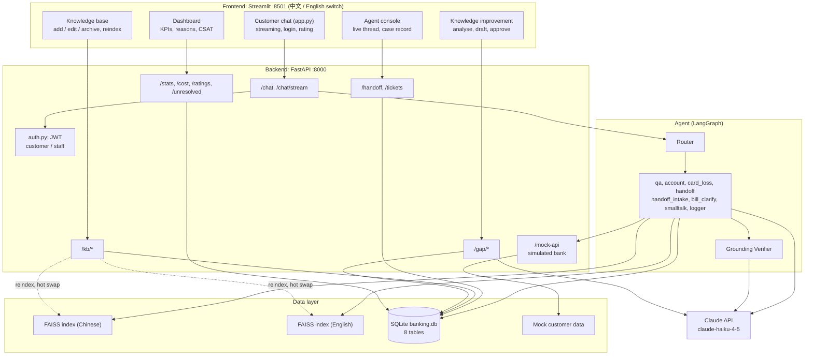
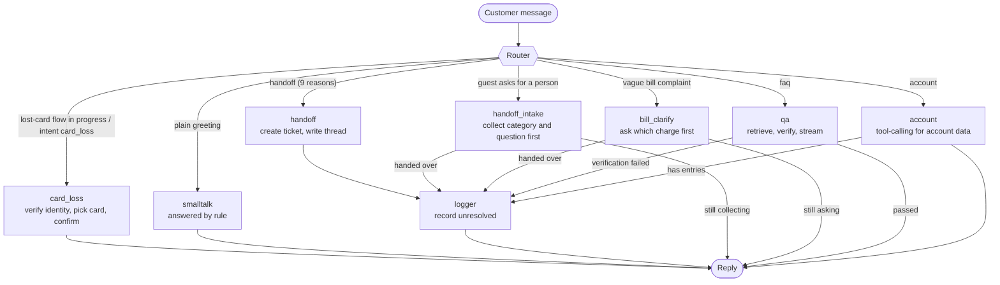
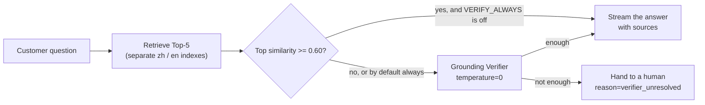
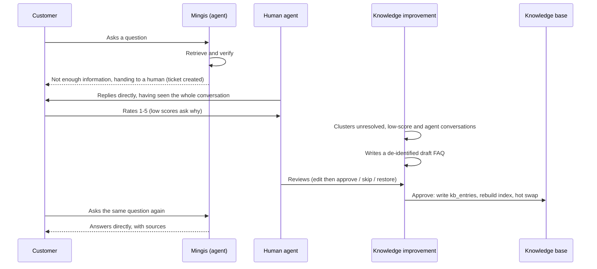

**English** · [繁體中文](architecture.zh-TW.md)

# Solution Architecture Document
# AI Banking Customer Assistant (Mingis): Final Architecture

| Field | Content |
|-------|---------|
| **Version** | v2.0 (final; matches the Sprint 22 code) |
| **Updated** | 2026-11-25 (English edition; the Chinese edition was last updated 2026-11-24) |
| **Supersedes** | v1.0 (2026-07-06 planning draft, when routing was plain functions; far from the current system) |
| **Basis** | Every number, file name, endpoint and table here is taken from the code. The reasons behind decisions are in [ADR.md](ADR.md); the evolution is in [design_journal.md](design_journal.md) *(Traditional Chinese)*. |

> Demo / portfolio project. The banking back office is a mock API; all customer and account data are fictional.

---

## 1. Overview

The system has four layers: **frontend (Streamlit) → backend (FastAPI) → agent (LangGraph + Claude) → data (SQLite + FAISS)**.
The core design is a **closed loop**: the AI answers when it can; when it cannot, or when the case is high risk, it hands over to a human agent; the agent's resolution is turned into a draft FAQ and, **after human review**, goes back into the knowledge base, so the next customer gets the answer from the AI directly.

Four principles run through the whole system:

| Principle | How it is done |
|-----------|----------------|
| **Answer only with evidence** | Answers come from retrieved knowledge. Before replying, a separate verification step decides whether "what was found is enough to answer"; if not, the case goes to a human instead of being guessed (ADR-010, ADR-020). |
| **Rules first, LLM second** | In-progress flows, greetings and vague bill complaints are handled by deterministic rules; everything else goes to the LLM classifier (ADR-009, 017, 018). |
| **A human at the critical points** | Nothing enters the knowledge base without human approval; reporting a lost card needs identity verification and an explicit confirmation; high-risk categories always go to a human. |
| **Measure before changing** | Every change is preceded by a measurement (retrieval score, handoff rate, latency, classification); results and their limits are recorded in [evaluation.md](evaluation.md) and the design journal. |

---

## 2. System architecture



---

## 3. Agent flow (LangGraph)

### 3.1 Graph structure (`backend/src/agent/graph.py`)



### 3.2 Router decision order (`router_node` in `nodes.py`)

Top to bottom; **the first match wins**:

| Order | Condition | Goes to | Why it comes before the LLM |
|-------|-----------|---------|------------------------------|
| 1 | A lost-card flow, guest intake or bill clarification is **already in progress** | Continue that flow | It is server-side state, not understanding this sentence |
| 2 | The frontend sets `force_handoff` (repeated unresolved turns reached the threshold) | `handoff` | Same |
| 3 | Plain greeting (hello, hi, thanks, bye) | `smalltalk` | Should neither query the knowledge base nor hand over (ADR-018) |
| 4 | Vague bill complaint ("something is wrong with my bill") | `bill_clarify` | Measurement showed the LLM classifier flips between two categories for the same sentence (ADR-017) |
| 5 | Everything else | LLM classifier (`intent.py`) → `faq` / `account` / `card_loss` / `handoff` | Understanding meaning |

The LLM classifier uses forced `tool_choice` structured output and `temperature=0`, so the same sentence always takes the same path.

### 3.3 The 9 handoff reasons (`handoff.py`)

| Reason code | Meaning | Priority |
|-------------|---------|----------|
| `handoff_urgent_fraud` | Suspected fraud (any charge the customer says they did not make, did not spend, or do not recognise) | **Urgent** |
| `handoff_dispute` | Billing dispute / refund (the customer did make the purchase, but it was charged twice, the amount is wrong, or the refund never arrived) | Normal |
| `handoff_approval_required` | Needs human approval (fee waiver, loan, limit) | Normal |
| `handoff_sensitive_data` | Sensitive data change | Normal |
| `handoff_emotional_distress` | Customer is upset | Normal |
| `handoff_cross_account` | Cross-account / cross-product | Normal |
| `handoff_intent` | The customer asks for a person | Normal |
| `fallback_threshold` | Repeatedly unresolved | Normal |
| `verifier_unresolved` | Verification judged the knowledge base insufficient | Normal |

Reporting a lost card (`card_loss`) has its own flow and also creates an **urgent** ticket.

### 3.4 The FAQ answer path (`qa_node`)



- By default `VERIFY_ALWAYS=1`: **verify before every reply**, regardless of score (ADR-020). Setting `0` restores "verify only when the score is below 0.60".
- A similarity score only means "relevant content was found"; it is **not answer accuracy**. 0.60 is a rule of thumb from a small number of cases, not a statistically calibrated value.
- The answer rules forbid adding reasons the knowledge base does not state, and forbid attributing a fee or decision to a third party (`prompts.py`).

---

## 4. The closed loop: from "can't answer" to "the system learned"



| Step | Implementation | Guardrail |
|------|----------------|-----------|
| Gather signals | Unresolved queries, low-score feedback, agent conversations (`gap_pipeline.gather_signals`) | Topics the knowledge base can already answer, and similar topics already skipped, are excluded |
| Cluster | LLM topic clustering that marks `kb_actionable` (`cluster_gaps`) | Topics a knowledge base cannot solve (for example one customer's account) produce no draft |
| Draft | `write_faq_draft` de-identifies and generalises personal data | Based only on what the agent actually replied; must not invent fees or policy |
| Approve | `POST /gap/drafts/{id}/approve` | **A person must approve**; the draft is claimed with a single database action so a double click cannot write two entries |
| Take effect | `_rebuild_and_swap_index`: rebuild, then swap the retriever in place | No restart needed |
| Effect | Retrieval score for the same question before and after; whether it is asked again | Only measures "found", never claims accuracy |

---

## 5. Data layer

### 5.1 SQLite (`data/banking.db`, `backend/src/database.py`)

| Table | Purpose |
|-------|---------|
| `tickets` | Service tickets: `T-YYYYMMDD-NNN-<8 chars>`, status (open / resolved), priority (normal / high), reason |
| `handoff_messages` | The conversation thread shared by agent and customer (both sides refresh every 5 seconds) |
| `unresolved_queries` | Unresolved queries and what triggered them (used by the Dashboard and knowledge improvement) |
| `satisfaction_ratings` | The 1-5 rating after a conversation and the reason for low scores |
| `kb_entries` | Supplementary knowledge (source `manual` or `pipeline`), merged into the vector index on reindex |
| `kb_gap_drafts` | FAQ drafts from knowledge improvement and their status (pending / approved / skipped) |
| `llm_calls` | Cost and latency of every Claude call (`tracing.py`; can be summed per call, per turn and per conversation) |
| `chat_sessions` | Conversation content, used to restore a chat from `?sid=` and to show a case's conversation |

Ticket reasons are stored in Chinese and translated to the current UI language only when displayed (ADR-019).

### 5.2 Knowledge base and vector index

| Item | Setting |
|------|---------|
| Source | `data/knowledge_base/{zh,en}/`, 9 markdown files each, plus `kb_entries` |
| Chunking | Split on `##` / `###` headings, CJK-aware, at most 320 units per chunk with 60 overlap; each chunk is embedded together with its heading path (ADR-016) |
| Embedding model | `paraphrase-multilingual-mpnet-base-v2` |
| Index | FAISS, **one index per language** (ADR-007), Top-K = 5 |
| Location | `data/faiss_index/`, produced by `build_index`, not under version control |

---

## 6. Backend API (`backend/main.py`, `backend/src/mock_api/api.py`)

| Group | Endpoints | Access |
|-------|-----------|--------|
| Chat | `POST /chat`, `POST /chat/stream` (token streaming), `GET /session/{id}`, `GET /suggestions`, `POST /rating` | Customer or guest (a conversation is identified by an unguessable session id; a rating that carries a user_id must match the JWT) |
| Authentication | `POST /mock-api/auth/login` (customer), `POST /auth/staff-login` (staff) | Public |
| Mock bank | `GET /mock-api/accounts/{balance,bill,transactions,cards,profile}` | Customer JWT |
| Human agents | `GET /handoff/tickets`, `GET/POST /handoff/{id}/messages`, `POST /handoff/{id}/{resolve,reopen,link-user}`, `GET /tickets`, `GET /tickets/{id}/record`, `GET /cases/by-session/{id}` | Staff |
| Knowledge base | `GET/POST /kb/entries`, `PUT /kb/entries/{id}`, `POST /kb/entries/{id}/{archive,restore}`, `POST /kb/reindex`, `GET /kb/retrieve`, `GET /kb/status` | Staff |
| Knowledge improvement | `POST /gap/analyze`, `GET /gap/drafts`, `PUT /gap/drafts/{id}`, `POST /gap/drafts/{id}/{approve,skip,restore}`, `GET /gap/drafts/{id}/effectiveness` | Staff |
| Reports | `GET /stats`, `/unresolved`, `/ratings`, `/cost/{summary,recent,session/{id}}` | Staff |
| Health | `GET /health` | Public |

Swagger docs: `http://localhost:8000/docs`.

---

## 7. Frontend (multi-page Streamlit)

| File | For | Function |
|------|-----|----------|
| `frontend/app.py` | Customer | Chat (streaming), login for account queries, live conversation after handoff, rating, suggested questions |
| `frontend/pages/1_Dashboard.py` | Manager | 4 KPIs, reason analysis, CSAT, clickable case conversations; cost and latency in a "developer info" block |
| `frontend/pages/2_客服人員介面.py` (Agent console) | Human agent | Urgent-first case list, live two-way conversation, mark resolved (reversible) |
| `frontend/pages/3_知識庫維護.py` (Knowledge base) | Knowledge ops | Add / edit / archive supplementary knowledge, reindex, retrieval test |
| `frontend/pages/4_知識優化.py` (Knowledge improvement) | Knowledge ops | Analyse, review FAQ drafts, restore a skipped draft, track the effect |
| `frontend/i18n.py`, `strings.py` | n/a | Platform-wide Chinese/English switch: one string table, language kept in the URL as `?lang=`; **English is the default** (the bilingual design is ADR-019) |
| `frontend/staff_auth.py`, `case_view.py`, `theme.py` | n/a | Staff login, case conversation dialog, theme |

---

## 8. Security and access control

| Item | Design | Note |
|------|--------|------|
| Identity | A customer's or staff member's identity can only come from a **JWT issued by this backend** (HS256), verified on every request that touches customer data or back-office tools | n/a |
| Authorisation | A customer can only reach their own data; `/kb/*`, `/gap/*`, `/handoff/*`, `/stats` and similar need staff identity (verified by `tests/security/`) | n/a |
| Secrets | API key, JWT secret and staff credentials live in `.env` (listed in `.gitignore`); the repository only has `.env.example`. **None of these values has a built-in default**: if one is missing, still an example value (such as `change_me`), or the JWT secret is shorter than 32 characters, the backend refuses to start and says how to fix it | `tests/test_secrets_required.py` guards this behaviour |
| High-risk flows | Suspected fraud is flagged urgent and handed to a human; a lost-card report needs identity verification and the customer's explicit confirmation | n/a |
| No dead ends | Guest intake and bill clarification each ask at most twice, so someone who wants a person is never trapped in a form | n/a |
| Data | All customers and accounts are fictional; FAQ drafts are de-identified | n/a |

---

## 9. Observability and quality assurance

| Item | Approach |
|------|----------|
| Cost and latency | Every Claude call goes through `traced_create` / `traced_stream` and is written to `llm_calls` (per call, per turn, per conversation) |
| Customer experience | CSAT 1-5, reasons for low scores, Dashboard statistics |
| Automated tests | 269 (latest full run) in `tests/`, `tests/eval/` and `tests/security/`, including evaluations and regression tests that call the real Claude |
| Evaluation record | [evaluation.md](evaluation.md): retrieval hit rate, intent classification, the verification-policy measurement and the fraud-routing measurement, **each with its sample size and limits** |
| Decision record | [ADR.md](ADR.md) (ADR-001 to 020), [design_journal.md](design_journal.md) *(Traditional Chinese)* |

---

## 10. Configuration (environment variables)

| Variable | Purpose |
|----------|---------|
| `ANTHROPIC_API_KEY` | Claude API key (required) |
| `JWT_SECRET_KEY` | JWT signing secret (**required, no default**, at least 32 characters) |
| `STAFF_USERNAME`, `STAFF_PASSWORD` | Shared staff login (**required, no default**) |
| `MAX_TOKENS`, `MAX_HISTORY_TURNS` | Answer length, and how many conversation turns to keep (defaults 1024 and 10) |
| `MOCK_API_BASE_URL` | Address of the mock bank API |
| `VERIFY_ALWAYS` | Default `1` (verify every time); `0` restores "verify only when the score is low" |
| `BANKING_DB_PATH` | Database path (tests use a separate database) |
| `APP_ENV` | Environment marker |

---

## 11. Project structure

```
mingis-banking-ai-agent/
├── backend/
│   ├── main.py                    FastAPI app and all endpoints
│   └── src/
│       ├── agent/
│       │   ├── graph.py           LangGraph wiring
│       │   ├── nodes.py           router / qa / account / card_loss / handoff / smalltalk / bill_clarify / logger
│       │   ├── intent.py          LLM intent classification (temperature=0, structured output)
│       │   ├── verifier.py        Grounding Verifier
│       │   ├── handoff.py         Tickets and threads, the 9 reasons
│       │   ├── gap_pipeline.py    Knowledge improvement: signals -> clusters -> drafts
│       │   ├── suggestions.py     Suggested questions (only those verified answerable)
│       │   ├── tools.py           Account tool-calling
│       │   └── state.py           AgentState
│       ├── rag/                   build_index.py (indexing), retriever.py (retrieval)
│       ├── mock_api/              Mock bank API and fake data
│       ├── auth.py                JWT
│       ├── database.py            SQLite schema and CRUD
│       ├── tracing.py             LLM cost and latency tracking
│       ├── prompts.py             System prompts and reply templates
│       ├── card_loss_workflow.py  Three-step lost-card flow
│       └── nlp.py                 Language detection, negative feedback
├── frontend/
│   ├── app.py                     Customer UI
│   ├── pages/                     Dashboard / Agent console / Knowledge base / Knowledge improvement
│   ├── i18n.py, strings.py        Chinese / English switch
│   └── staff_auth.py, case_view.py, theme.py
├── data/knowledge_base/{zh,en}/   Knowledge-base markdown (9 files each)
├── docs/                          Design documents (see section 13)
├── tests/                         pytest (including eval/ and security/)
├── .env.example
└── README.md
```

---

## 12. Known limitations and the path to production

### Known limitations (recorded honestly)

| Item | Current state |
|------|---------------|
| **Staff identity** | Everyone shares one login; there are no individual accounts or permission levels |
| **Database** | SQLite, single machine, single process; no concurrency or backup design |
| **Evaluation samples** | The test questions are small, hand-picked samples (a few dozen); the results show "the gap is closed", not an overall accuracy rate |
| **Cost of verification** | Verifying before every reply adds about 3 seconds before the first word, and more answerable questions are handed over (3 → 11 out of 62; 4 of those 11 were retrieval misses) |
| **No traffic control** | No rate limiting or caching; the volume of Claude calls is entirely up to the users |
| **Scope** | The bank back office is a mock; compliance with data-protection and financial regulation is not addressed |

### If this were taken to production

| Now | Production |
|-----|------------|
| Streamlit | A front-end framework separate from the backend |
| SQLite | PostgreSQL |
| Single-machine run | Containerised deployment |
| Local FAISS index | A vector database (for example pgvector or Pinecone) |
| Mock API | A real core-banking API |
| Shared staff login | Individual accounts, role-based permissions, audit trail |
| No traffic control | Rate limiting, usage caps, caching |
| Knowledge improvement triggered by hand | Scheduled analysis plus a review queue |

---

## 13. Document map

Documents marked *(Traditional Chinese)* have no English edition yet.

| Document | Content | Status |
|----------|---------|--------|
| [README.md](../README.md) | Project introduction, features, quick start | Current |
| **This document** | Final architecture | Current |
| [ADR.md](ADR.md) | 20 technical decisions (reasons and trade-offs); ADR-002 records Sprint 1's plain-function routing, replaced by LangGraph from Sprint 6 | Current |
| [evaluation.md](evaluation.md) | Measurement methods, results and limits | Current |
| [design_journal.md](design_journal.md) *(Traditional Chinese)* | The design process and reflections, sprint by sprint | Current |
| [PRD.md](PRD.md), [conversation_design.md](conversation_design.md), [user_flow.md](user_flow.md), [agent_design.md](agent_design.md) *(Traditional Chinese)* | Planning-era documents (v1.0) | **Historical record**; for details, trust this document and the code |
| [prompt_engineering/](prompt_engineering/) *(Traditional Chinese)* | Prompt design notes | Historical record |

---

*v1.0 was the planning-era version (plain-function routing; module names and the similarity threshold have all changed). This v2.0 was rewritten from the final code.*
