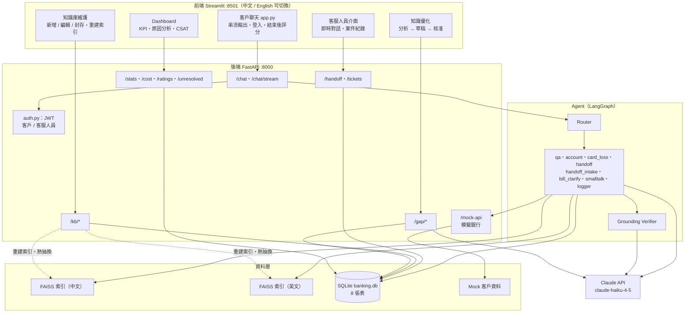
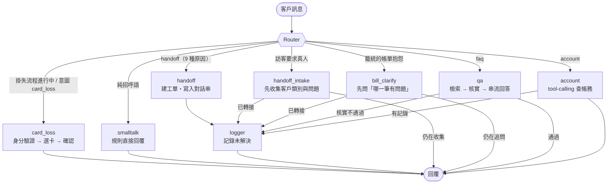
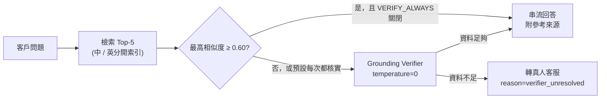
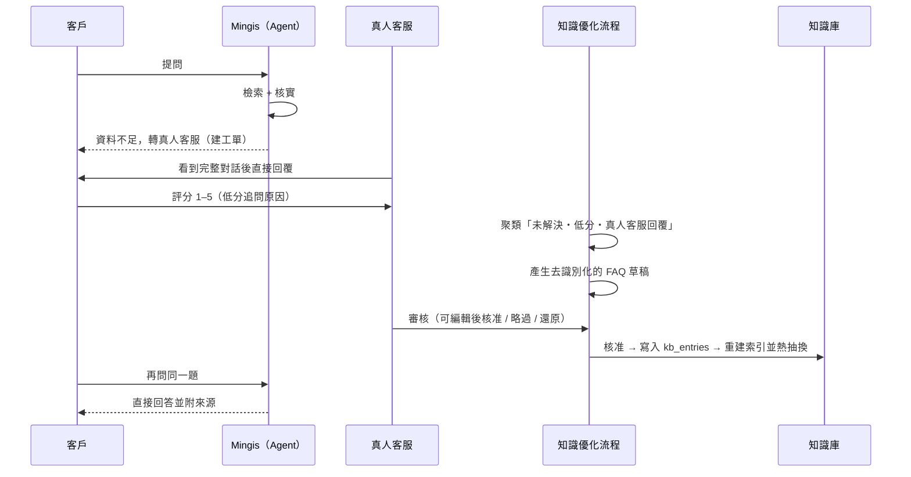

# Solution Architecture Document
# AI Banking Customer Assistant（Mingis）— 最終版架構

| 欄位 | 內容 |
|------|------|
| **文件版本** | v2.0（最終版，對應 Sprint 22 的程式碼） |
| **更新日期** | 2026-11-24 |
| **取代** | v1.0（2026-07-06 規劃期版本；當時是函式路由，與現況差距大） |
| **依據** | 本文所有數字、檔名、端點、資料表皆取自程式碼；決策原因見 [ADR.md](ADR.md)，演進過程見 [design_journal.md](design_journal.md) |

> Demo / 作品專案。銀行後台為 Mock API，所有客戶與帳務資料皆為虛構。

---

## 1. 架構總覽

系統分四層：**前端（Streamlit）→ 後端（FastAPI）→ Agent（LangGraph + Claude）→ 資料（SQLite + FAISS）**。
核心設計是一個**閉環**：AI 答得出來就回答；答不出來或屬於高風險，就交給真人客服；真人客服的解法會被整理成 FAQ 草稿，
**經人工審核**後回到知識庫，下一位客戶就能由 AI 直接得到答案。

四個貫穿全系統的設計原則：

| 原則 | 具體做法 |
|------|----------|
| **有依據才回答** | 答案來自檢索到的知識；回答前由獨立的核實步驟判斷「找到的內容夠不夠回答」，不夠就轉真人客服，不硬答（ADR-010、ADR-020） |
| **規則在前、LLM 在後** | 進行中的流程、招呼語、籠統的帳單抱怨等用確定性規則先處理，其餘才交給 LLM 分類器（ADR-009、017、018） |
| **人在關鍵點** | 任何內容要進知識庫都必須人工核准；掛失要驗證身分並明確確認；高風險類別一律轉真人 |
| **先量測再修改** | 每次改動前先量測（檢索分數、轉接率、延遲、分類結果），結果與限制記錄在 [evaluation.md](evaluation.md) 與設計日誌 |

---

## 2. 系統架構圖



---

## 3. Agent 流程（LangGraph）

### 3.1 圖結構（`backend/src/agent/graph.py`）



### 3.2 Router 的判斷順序（`nodes.py` 的 `router_node`）

由上而下，**先符合先處理**：

| 順序 | 條件 | 走向 | 為什麼放在 LLM 之前 |
|------|------|------|----------------------|
| 1 | 掛失、轉接資料收集、帳單追問**已在進行中** | 繼續該流程 | 這是伺服器端的狀態，不是在理解這句話 |
| 2 | 前端標記 `force_handoff`（連續未解決達門檻） | `handoff` | 同上 |
| 3 | 純招呼語（你好、Hi、謝謝、再見） | `smalltalk` | 不該查知識庫，也不該轉人（ADR-018） |
| 4 | 籠統的帳單抱怨（「帳單金額有問題」） | `bill_clarify` | 量測發現 LLM 分類器對同一句話會在兩個分類間搖擺（ADR-017） |
| 5 | 其餘 | LLM 分類器（`intent.py`） → `faq` / `account` / `card_loss` / `handoff` | 理解語意 |

LLM 分類器以 `tool_choice` 強制結構化輸出、`temperature=0`，同一句話永遠走同一條路。

### 3.3 轉真人客服的 9 種原因（`handoff.py`）

| 原因代碼 | 說明 | 優先度 |
|----------|------|--------|
| `handoff_urgent_fraud` | 疑似盜刷／詐騙（凡是客戶說不是自己消費、沒花過、不認識的款項） | **緊急** |
| `handoff_dispute` | 帳務爭議／退款（自己消費過，但重複扣款、金額錯誤、退款沒收到） | 一般 |
| `handoff_approval_required` | 需人工核准（減免、貸款、額度） | 一般 |
| `handoff_sensitive_data` | 敏感資料變更 | 一般 |
| `handoff_emotional_distress` | 情緒激動 | 一般 |
| `handoff_cross_account` | 跨帳戶／跨產品 | 一般 |
| `handoff_intent` | 客戶主動要求真人 | 一般 |
| `fallback_threshold` | 連續未解決 | 一般 |
| `verifier_unresolved` | 核實後判定知識庫不足 | 一般 |

信用卡掛失（`card_loss`）另有流程，建立的工單同樣為**緊急**。

### 3.4 FAQ 回答路徑（`qa_node`）



- 預設 `VERIFY_ALWAYS=1`：**每次回答前都核實**，不論分數高低（ADR-020）。設為 `0` 可退回「只在分數低於 0.60 時核實」。
- 相似度分數只代表「找到相關內容」，**不代表答案正確率**；0.60 是少量案例得出的經驗值，不是統計校準的結果。
- 回答規則禁止補充知識庫沒有提到的理由，也不得把費用或決定歸因於第三方（`prompts.py`）。

---

## 4. 閉環：從答不出來到系統學會



| 步驟 | 實作 | 護欄 |
|------|------|------|
| 蒐集訊號 | 未解決查詢、低分回饋、真人客服對話（`gap_pipeline.gather_signals`） | 已能被知識庫答出的、已略過的相近主題會被排除 |
| 聚類 | LLM 主題聚類，標記 `kb_actionable`（`cluster_gaps`） | 不屬於知識庫能解決的主題（例如個別帳務）不產生草稿 |
| 草稿 | `write_faq_draft`，去識別化並一般化客戶的個資 | 只根據客服實際回覆，不得編造費用與政策 |
| 核准 | `POST /gap/drafts/{id}/approve` | **一定要人工核准**；以單一資料庫動作搶佔草稿，避免重複核准寫入兩筆 |
| 生效 | `_rebuild_and_swap_index`：重建索引後就地抽換 retriever | 不需重啟 |
| 成效 | 同一題核准前後的檢索分數、之後是否再被問到 | 只量「找得到」，不宣稱準確率 |

---

## 5. 資料層

### 5.1 SQLite（`data/banking.db`，`backend/src/database.py`）

| 資料表 | 用途 |
|--------|------|
| `tickets` | 服務單：`T-YYYYMMDD-NNN-<8碼>`、狀態（open / resolved）、優先度（normal / high）、原因 |
| `handoff_messages` | 真人客服與客戶共用的對話串（客服端與客戶端每 5 秒自動更新） |
| `unresolved_queries` | 未解決查詢與觸發原因（供 Dashboard 與知識優化使用） |
| `satisfaction_ratings` | 結束對話後的 1–5 分評分與低分原因 |
| `kb_entries` | 補充知識（來源 `manual` 或 `pipeline`），重建索引時併入向量索引 |
| `kb_gap_drafts` | 知識優化產生的 FAQ 草稿與狀態（pending / approved / skipped） |
| `llm_calls` | 每次 Claude 呼叫的成本與延遲（`tracing.py`，可依呼叫、回合、對話彙總） |
| `chat_sessions` | 對話內容，用於網址 `?sid=` 還原與案件對話顯示 |

工單原因以中文存入資料庫，顯示時才翻譯成目前介面語言（ADR-019）。

### 5.2 知識庫與向量索引

| 項目 | 設定 |
|------|------|
| 來源 | `data/knowledge_base/{zh,en}/` 各 9 份 markdown，加上 `kb_entries` |
| 切塊 | 以 `##` / `###` 標題為邊界、對中日韓文字感知，單塊最多 320 單位、重疊 60；每塊帶標題路徑一起嵌入（ADR-016） |
| 嵌入模型 | `paraphrase-multilingual-mpnet-base-v2` |
| 索引 | FAISS，**中文與英文各一份**（ADR-007），Top-K = 5 |
| 位置 | `data/faiss_index/`，由 `build_index` 產生、不進版本控制 |

---

## 6. 後端 API（`backend/main.py`、`backend/src/mock_api/api.py`）

| 群組 | 端點 | 存取 |
|------|------|------|
| 對話 | `POST /chat`、`POST /chat/stream`（逐字串流）、`GET /session/{id}`、`GET /suggestions`、`POST /rating` | 客戶或訪客（對話以不易猜測的 session id 識別；評分若帶 user_id 須與 JWT 相符） |
| 驗證 | `POST /mock-api/auth/login`（客戶）、`POST /auth/staff-login`（客服人員） | 公開 |
| 模擬銀行 | `GET /mock-api/accounts/{balance,bill,transactions,cards,profile}` | 客戶 JWT |
| 真人客服 | `GET /handoff/tickets`、`GET/POST /handoff/{id}/messages`、`POST /handoff/{id}/{resolve,reopen,link-user}`、`GET /tickets`、`GET /tickets/{id}/record`、`GET /cases/by-session/{id}` | 客服人員 |
| 知識庫 | `GET/POST /kb/entries`、`PUT /kb/entries/{id}`、`POST /kb/entries/{id}/{archive,restore}`、`POST /kb/reindex`、`GET /kb/retrieve`、`GET /kb/status` | 客服人員 |
| 知識優化 | `POST /gap/analyze`、`GET /gap/drafts`、`PUT /gap/drafts/{id}`、`POST /gap/drafts/{id}/{approve,skip,restore}`、`GET /gap/drafts/{id}/effectiveness` | 客服人員 |
| 報表 | `GET /stats`、`/unresolved`、`/ratings`、`/cost/{summary,recent,session/{id}}` | 客服人員 |
| 健康檢查 | `GET /health` | 公開 |

Swagger 文件：`http://localhost:8000/docs`。

---

## 7. 前端（Streamlit 多頁）

| 檔案 | 給誰 | 功能 |
|------|------|------|
| `frontend/app.py` | 客戶 | 聊天（串流）、登入查帳務、轉真人後的即時對話、結束後評分、常見問題捷徑 |
| `frontend/pages/1_Dashboard.py` | 管理者 | 4 張 KPI、原因分析、CSAT、可點開的案件對話；成本與延遲收在「開發者資訊」 |
| `frontend/pages/2_客服人員介面.py` | 真人客服 | 緊急優先的案件列表、即時雙向對話、標記已解決（可復原） |
| `frontend/pages/3_知識庫維護.py` | 知識維運 | 補充知識的新增 / 編輯 / 封存、重建索引、檢索測試 |
| `frontend/pages/4_知識優化.py` | 知識維運 | 分析、審核 FAQ 草稿、略過後可還原、成效追蹤 |
| `frontend/i18n.py`、`strings.py` | — | 全平台中英文切換：集中字串表、語言記在網址 `?lang=`（ADR-019） |
| `frontend/staff_auth.py`、`case_view.py`、`theme.py` | — | 客服人員登入、案件對話視窗、主題樣式 |

---

## 8. 安全性與存取控制

| 項目 | 設計 | 注意事項 |
|------|------|----------|
| 身分 | 客戶與客服人員的身分只能來自**本後端簽發的 JWT**（HS256），每次涉及客戶資料或後台功能的請求都驗證 | — |
| 授權 | 客戶只能存取自己的資料；`/kb/*`、`/gap/*`、`/handoff/*`、`/stats` 等需客服人員身分（`tests/security/` 驗證） | — |
| 祕密管理 | API 金鑰、JWT 密鑰、客服帳密放 `.env`（已列入 `.gitignore`），repo 只有 `.env.example`。**這些值沒有任何內建預設**：缺少、仍是範例值（如 `change_me`）、或 JWT 密鑰短於 32 字元時，後端拒絕啟動並說明如何修正 | `tests/test_secrets_required.py` 守住這個行為 |
| 高風險流程 | 疑似盜刷標為緊急並轉真人；掛失須驗證身分後由客戶明確確認 | — |
| 防止卡住 | 訪客資料收集、帳單追問最多各 2 次，不會把想找真人的人困在表單裡 | — |
| 資料 | 全部為虛構的客戶與帳務；FAQ 草稿會去識別化 | — |

---

## 9. 可觀測性與品質保證

| 項目 | 做法 |
|------|------|
| 成本與延遲 | 所有 Claude 呼叫都經 `traced_create` / `traced_stream`，寫入 `llm_calls`（可看每次呼叫、每回合、每段對話） |
| 客戶體驗 | CSAT 1–5 分、低分原因、Dashboard 統計 |
| 自動化測試 | 269 個（最近一次完整執行），位於 `tests/`、`tests/eval/`、`tests/security/`；包含會呼叫真實 Claude 的評估與回歸測試 |
| 評估紀錄 | [evaluation.md](evaluation.md)：檢索命中率、意圖分類、核實政策量測、盜刷判斷量測，**每項都標明樣本數與限制** |
| 決策紀錄 | [ADR.md](ADR.md)（ADR-001 至 020）、[design_journal.md](design_journal.md) |

---

## 10. 設定（環境變數）

| 變數 | 用途 |
|------|------|
| `ANTHROPIC_API_KEY` | Claude API 金鑰（必填） |
| `JWT_SECRET_KEY` | JWT 簽章密鑰（**必填、沒有預設**，至少 32 字元） |
| `STAFF_USERNAME`、`STAFF_PASSWORD` | 客服人員共用帳密（**必填、沒有預設**） |
| `MAX_TOKENS`、`MAX_HISTORY_TURNS` | 回答長度、保留的對話輪數（預設 1024、10） |
| `MOCK_API_BASE_URL` | Mock 銀行 API 位址 |
| `VERIFY_ALWAYS` | 預設 `1`（每次核實）；`0` 退回「只在低分時核實」 |
| `BANKING_DB_PATH` | 資料庫路徑（測試用獨立資料庫） |
| `APP_ENV` | 執行環境標記 |

---

## 11. 專案目錄結構

```
mingis-banking-ai-agent/
├── backend/
│   ├── main.py                    FastAPI 應用與所有端點
│   └── src/
│       ├── agent/
│       │   ├── graph.py           LangGraph 接線
│       │   ├── nodes.py           router / qa / account / card_loss / handoff / smalltalk / bill_clarify / logger
│       │   ├── intent.py          LLM 意圖分類（temperature=0、結構化輸出）
│       │   ├── verifier.py        Grounding Verifier
│       │   ├── handoff.py         工單與對話串、9 種原因
│       │   ├── gap_pipeline.py    知識優化：訊號 → 聚類 → 草稿
│       │   ├── suggestions.py     常見問題捷徑（只含驗證過答得出來的）
│       │   ├── tools.py           帳務 tool-calling
│       │   └── state.py           AgentState
│       ├── rag/                   build_index.py（建索引）、retriever.py（檢索）
│       ├── mock_api/              Mock 銀行 API 與假資料
│       ├── auth.py                JWT
│       ├── database.py            SQLite schema 與 CRUD
│       ├── tracing.py             LLM 成本與延遲追蹤
│       ├── prompts.py             system prompt 與回覆模板
│       ├── card_loss_workflow.py  掛失三步驟流程
│       └── nlp.py                 語言偵測、否定回饋
├── frontend/
│   ├── app.py                     客戶端
│   ├── pages/                     Dashboard / 客服人員介面 / 知識庫維護 / 知識優化
│   ├── i18n.py、strings.py        中英文切換
│   └── staff_auth.py、case_view.py、theme.py
├── data/knowledge_base/{zh,en}/   知識庫 markdown（各 9 份）
├── docs/                          設計文件（見第 13 節）
├── tests/                         pytest（含 eval/、security/）
├── .env.example
└── README.md
```

---

## 12. 已知限制與生產環境路徑

### 已知限制（如實記錄）

| 項目 | 現況 |
|------|------|
| **客服人員身分** | 全員共用同一組帳密，沒有個別帳號與權限分級 |
| **資料庫** | SQLite 單機單程序，沒有並發與備份設計 |
| **評估樣本** | 測試題目為人工挑選的小樣本（幾十題），結果只能說明「漏洞已補上」，不是整體準確率 |
| **核實的代價** | 每次回答前核實使首字多等約 3 秒，且可回答的問題也會有較多被轉出（62 題中 3 題 → 11 題，其中 4 題是檢索失誤） |
| **無流量控制** | 沒有 rate limiting 與快取，Claude 呼叫量完全由使用者決定 |
| **範圍** | 銀行後台為 Mock；未涉及個資法、金管會等法規遵循 |

### 若要生產化

| 現在 | 生產環境 |
|------|----------|
| Streamlit | 前後端分離的前端框架 |
| SQLite | PostgreSQL |
| 單機執行 | 容器化部署 |
| FAISS 本地索引 | 向量資料庫（如 pgvector / Pinecone） |
| Mock API | 真實核心銀行 API |
| 共用客服帳密 | 個別帳號、角色權限、稽核紀錄 |
| 無流量控制 | Rate limiting、用量上限、快取 |
| 手動觸發知識優化 | 排程分析 + 審核佇列 |

---

## 13. 文件地圖

| 文件 | 內容 | 狀態 |
|------|------|------|
| [README.md](../README.md) | 專案介紹、功能、快速開始 | 最新 |
| **本文件** | 最終版架構 | 最新 |
| [ADR.md](ADR.md) | 20 項技術決策（原因、取捨）；ADR-002 記錄的是 Sprint 1 的函式路由，Sprint 6 起已改用 LangGraph | 最新 |
| [evaluation.md](evaluation.md) | 量測方法、結果與限制 | 最新 |
| [design_journal.md](design_journal.md) | 各 Sprint 的設計過程與反思 | 最新 |
| [PRD.md](PRD.md)、[conversation_design.md](conversation_design.md)、[user_flow.md](user_flow.md)、[agent_design.md](agent_design.md) | 規劃期文件（v1.0） | **歷史紀錄**，細節以本文件與程式碼為準 |
| [prompt_engineering/](prompt_engineering/) | Prompt 設計紀錄 | 歷史紀錄 |

---

*v1.0 為規劃期版本（函式路由、模組名稱與相似度門檻皆已更動）；本文件 v2.0 依最終版程式碼重寫。*
